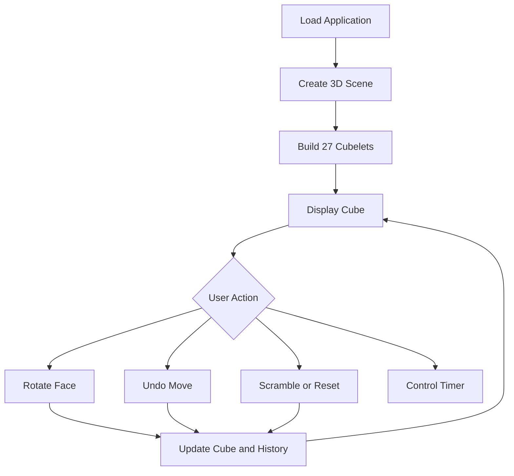

# 🧊 CubeSolver 3D

An interactive 3D Rubik's Cube web application built using JavaScript and Three.js.

## ✨ Features

- Interactive 3D Rubik's Cube
- Face rotation controls: R, L, U, D, F, B
- Clockwise, inverse and double moves
- Move history and Undo Last Move
- Reset Cube and Scramble Cube
- Manual Solve Timer
- Responsive dark-themed UI
- Move notation guide

## 🛠️ Technologies Used

| Technology | Purpose |
|---|---|
| HTML5 | Webpage structure |
| CSS3 | Styling and responsive design |
| JavaScript | Application logic |
| Three.js | 3D cube rendering |
| OrbitControls | Interactive camera |
| Vite | Development server and build tool |

## 📁 Project Structure

```text
cube-setup/
├── index.html
├── package.json
├── package-lock.json
├── README.md
└── src/
    ├── main.js
    └── style.css
```

## ⚙️ Installation and Setup

**Prerequisites:** Node.js and npm.

1. Open the project folder in VS Code.
2. Install dependencies:

   ```bash
   npm install
   ```

3. Start the development server:

   ```bash
   npm run dev
   ```

4. Open the local URL shown in the terminal, usually `http://localhost:5173/`.

## 📦 Important Imports

```javascript
import './style.css';
import * as THREE from 'three';
import { OrbitControls } from 'three/addons/controls/OrbitControls.js';
```

- `style.css` loads the application styling.
- `three` provides the 3D scene, camera, renderer, lights and cubelets.
- `OrbitControls` allows users to rotate the camera around the cube.

## 🔄 How It Works



## 🧊 3D Cube Visualization

The cube consists of 27 smaller cubes arranged in a 3 × 3 × 3 structure.

- **Scene:** Contains the 3D objects and lights.
- **Camera:** Determines the viewing perspective.
- **Renderer:** Displays the scene in the browser.
- **Cubelets:** Individual meshes created using `BoxGeometry` and materials.
- **Pivot Group:** Rotates selected cubelets together.
- **Animation:** Uses `requestAnimationFrame()` for smooth face turns.

## 🎮 Move Notation

| Notation | Meaning |
|---|---|
| `R`, `L` | Right and left faces |
| `U`, `D` | Upper and bottom faces |
| `F`, `B` | Front and back faces |
| `'` | Inverse turn |
| `2` | 180-degree turn |

## ⏱️ Solve Timer

The timer supports manual Start, Stop, Resume and Reset actions. It displays elapsed time in `MM:SS.CC` format.


## 🚀 Future Improvements

- Automatic cube-solving algorithm
- Best-time tracking and solve statistics
- Improved move validation
- Deployment for public access

